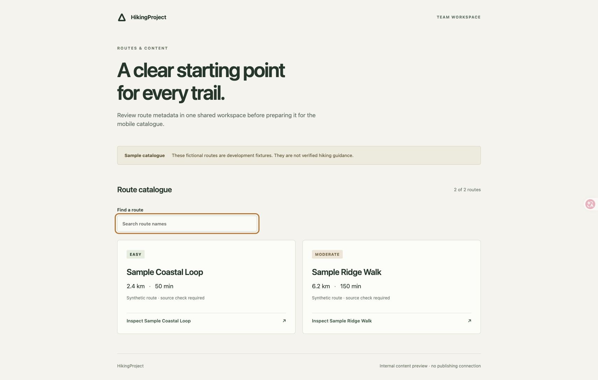
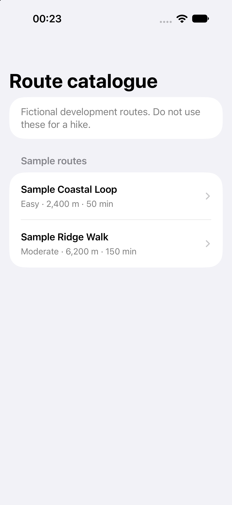

# Foundation validation record

Recorded **13 November 2026 (Pacific/Auckland)** for [Issue #7](https://github.com/RIOne1/HikingProject/issues/7), branch `build/7-mobile-web-foundation`. These results apply to the bootstrap scope and synthetic fixtures. They do not mark any MVP requirement accepted. Commands below ran from the repository root; logs and Xcode results are local ignored files under `tmp/foundation/`.

## Local evidence

| Check | Environment | Result |
| --- | --- | --- |
| `swift test --scratch-path tmp/foundation/swift-build --disable-automatic-resolution --jobs 2` | macOS, Swift 6.4.2 | Passed: 8 Swift Testing functions, including 4 numeric-validation cases; persistence/reopen, parameterized SQL and write-failure rollback |
| `npm ci` followed by `npm run check:web` | Node 24.20.0, npm 11.19.0 | Passed: ESLint, 13 Vitest tests including JSON Schema checks, TypeScript checking and Vite production build |
| npm installation audit | Same locked dependency graph | 0 known vulnerabilities reported after the documented minimatch override; this is not a complete dependency security review |
| `xcodebuild -resolvePackageDependencies -project apps/mobile/HikingProject.xcodeproj -scheme HikingProject` | Xcode 27.2 | Passed: GRDB 7.12.0, Mapbox 11.34.2 and transitive dependencies resolved without entering a map credential |
| `xcodebuild test -project apps/mobile/HikingProject.xcodeproj -scheme HikingProject -destination 'platform=iOS Simulator,id=2A18306D-5CB2-4976-8FB2-B3913DEB00D4' -derivedDataPath tmp/foundation/DerivedData -resultBundlePath tmp/foundation/ios-tests-2.xcresult CODE_SIGNING_ALLOWED=NO` | iPhone 18 Pro simulator, iOS 27.2 | Passed: app compiled and 1 XCTest UI scenario browsed the sample, opened details, checked tokenless map state/distance and relaunched |
| Browser scenario: catalogue → search `ridge` → inspect → close → unmatched search → clear | Chrome, local Vite production preview | Passed; metadata, selection and empty state matched the fixture. Development-mode catalogue also displayed after restarting Vite following dependency installation |
| `python3 scripts/ci/check_docs.py`; `git diff --cached --check`; XcodeGen regeneration comparison; YAML parsing | Local working tree | Passed: 13 Markdown files, bilingual structure/links, whitespace, stable generated project and valid workflow YAML |
| `python3 -m unittest discover -s scripts/ci -p 'test_*.py' -v` | Python 3.14 | Passed: 15 governance/document-validator regression tests |

The first UI run exposed an incorrect assumption that SwiftUI `LabeledContent` exposes its value separately. The final test identifies the combined accessibility element and still asserts the actual distance. No production assertion was removed to obtain a pass. Restart a running Vite server after dependency replacement; an already-running process can retain stale optimized modules.

The root `Package.resolved` records the resolved graph used here, including Mapbox's transitive versions. The portable package only depends on GRDB; its locked test command does not compile the map SDK. Both Swift and npm lockfiles belong in review.

## CI and remaining gates

The workflow runs Web and portable Swift tests inside the existing required `Documentation integrity` check, alongside the unchanged `Contribution policy` check. In the first [remote run](https://github.com/RIOne1/HikingProject/actions/runs/43209471551), contribution checks, document checks and all Web checks passed on `HikingProject-PC`; Swift setup failed because the Ubuntu runner image lacks `file`, so Linux Swift tests did not run. The [CI guide](CI.md#ubuntu-2404-image-preparation) provides the concrete image prerequisites. A prerequisite check now reports missing tools before setup; the Draft PR tracks the latest run. Do not merge with a failed or missing required check.

Not run / not implemented: real-device installation, iOS 18 runtime coverage, token-enabled map rendering, offline packs, SDK telemetry/privacy behaviour, location permissions, foreground/background recording, notification delivery, battery endurance, GPX import/export, genuine route geometry/provenance, earlier-version schema upgrades, abrupt process interruption and App Store distribution. These remain their feature/product/release gates, not claims established by a sample catalogue. No paid service, Apple enrollment, Mapbox account activation, hosted runner or deployment was performed.

## Screenshots

Only synthetic fixture content is shown.

